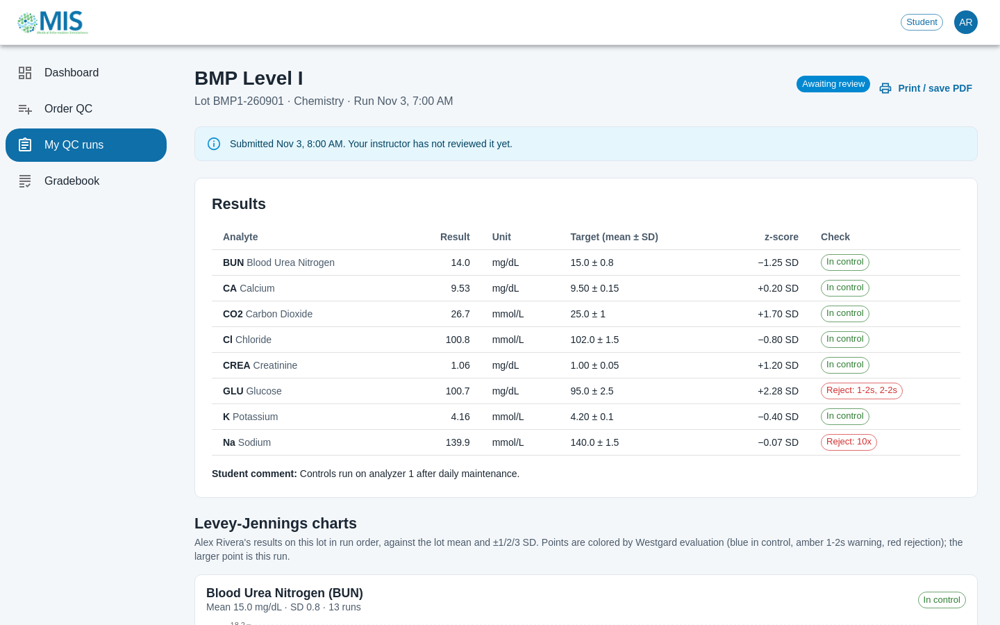
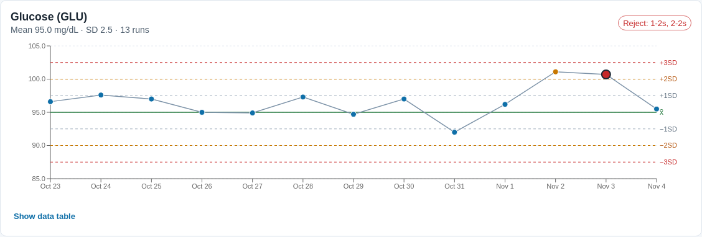
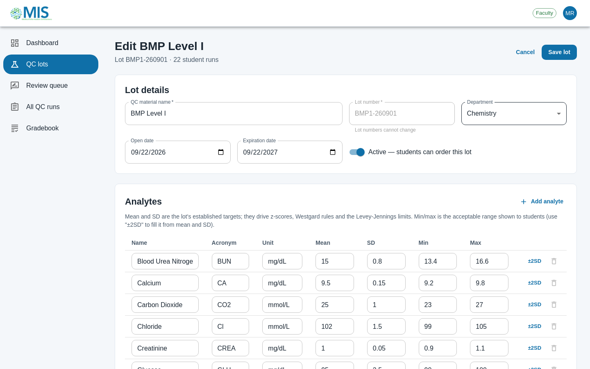
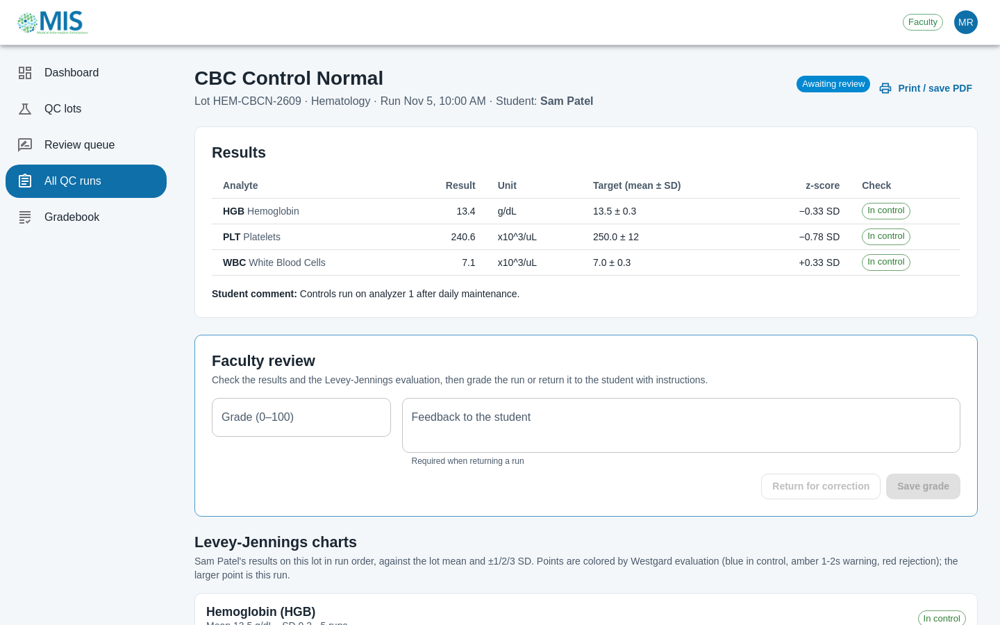
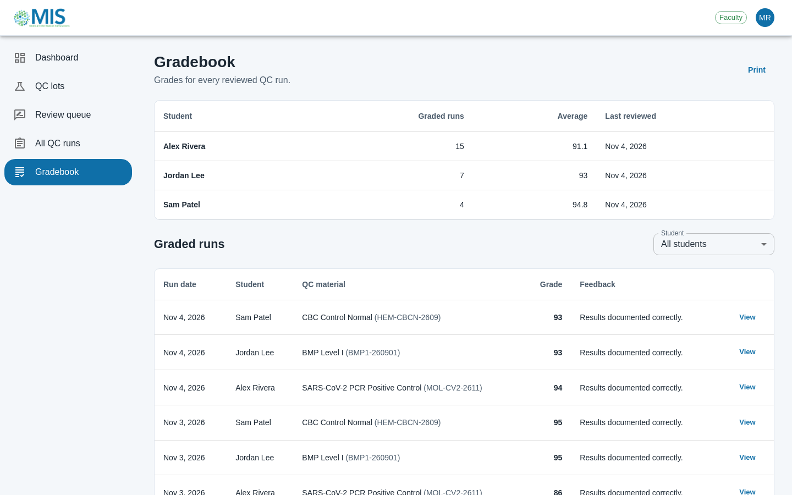
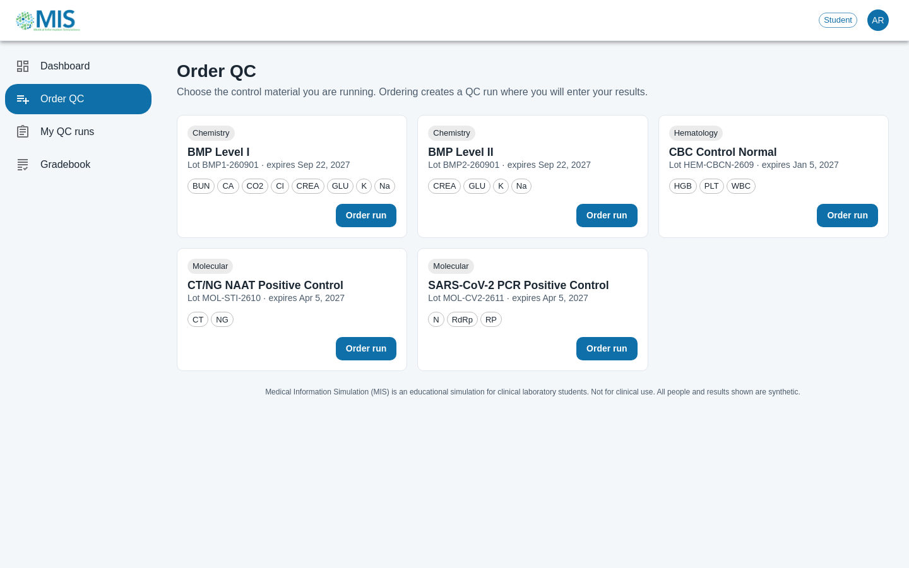
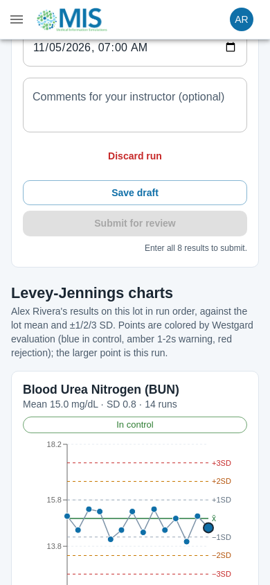
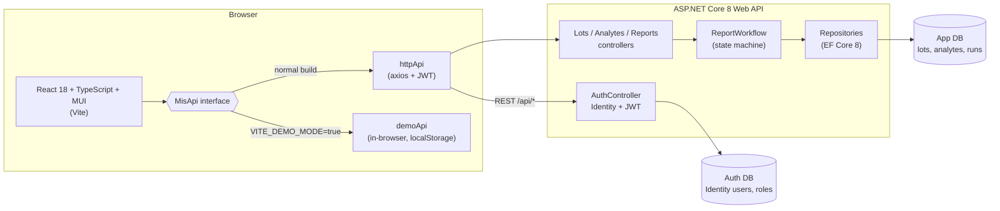

# Medical Information Simulation (MIS)

MIS is a web app for teaching laboratory quality control (QC) to clinical lab science students. Faculty set up QC
lots with target values. Students run QC, enter results, and read their own Levey-Jennings charts with Westgard
rule evaluation. Faculty then review, grade or return each run, and the grades appear in a gradebook.

> **Educational simulation only. Not for clinical use.** Every person, account and result in this repository and in
> the demo is synthetic.

It started as a team capstone at Texas Tech University Health Sciences Center ("Medical Information Simulation
website for the TTU HSC"). This branch (`finish-mis`) completes the core workflow end to end. See
[Credits](#credits) for who built what.

**Live demo (runs in your browser, no server):** https://scrumdumpstersmis.web.app
Sign in with one of the demo accounts shown on the login page. The demo keeps its data in your browser's
localStorage; *Account → Reset demo data* restores the seed.



## What it does

| Step | Who | Where |
| --- | --- | --- |
| 1. Create and edit QC lots: material, lot number, department, open and expiration dates, analytes with mean, SD and acceptable range | Faculty | *QC lots* |
| 2. Order a QC run on an active, unexpired lot and enter results, with live z-scores and Westgard checks | Student | *Order QC* → run page |
| 3. Read Levey-Jennings charts for every analyte on that lot (mean, ±1/2/3 SD, points colored by rule result, plus an accessible data table) | Student, Faculty | run page |
| 4. Submit the run for review (drafts can be saved first) | Student | run page |
| 5. Grade the run (0–100, with feedback), or return it for correction, after which the student fixes it and resubmits | Faculty | *Review queue* |
| 6. See grades: per-student averages for faculty, and own graded runs with feedback for students | Both | *Gradebook* |

Run lifecycle: `InProgress → Submitted → Graded`, with `Submitted → Returned → Submitted` for corrections. The API
enforces the transitions (`Services/ReportWorkflow.cs`).

### QC definitions used

- **z-score** = (result − lot mean) / lot SD.
- **Levey-Jennings chart**: results in run order against the mean and ±1, ±2 and ±3 SD lines.
- **Westgard rules** (`client/src/qc/westgard.ts`). Each run is evaluated with the runs before it, as a tech would at
  the bench:
  - `1-2s`: warning, one result beyond ±2 SD.
  - `1-3s`: reject, one result beyond ±3 SD.
  - `2-2s`: reject, two consecutive results beyond 2 SD on the same side.
  - `R-4s`: reject, two consecutive results more than 4 SD apart.
  - `4-1s`: reject, four consecutive results beyond 1 SD on the same side.
  - `10x`: reject, ten consecutive results on one side of the mean.

  R-4s is classically a within-run rule across two control levels. MIS records one control level per run, so it applies
  R-4s across consecutive runs instead ([DECISIONS.md](docs/DECISIONS.md)).

## Screenshots

These were captured from the app running locally against SQL Server with the synthetic seed data.

| | |
| --- | --- |
|  |  |
| Glucose drifts above +2 SD on two consecutive runs, a 2-2s rejection (planted in the seed). | Faculty edit a lot's analytes. Mean and SD drive the z-scores, rules and chart limits. |
|  |  |
| Faculty grade a submitted run or return it with instructions. | The gradebook shows per-student averages and every graded run. |
|  |  |
| Students order a run on any active lot. | The layout works at phone width (390 px). |

## Architecture



- **API** (`api/ScrumDumpsterMolecularDiagnostic`):
  - .NET 8, EF Core 8, ASP.NET Core Identity, JWT bearer auth.
  - Authorization is deny-by-default (a fallback policy) with two roles, faculty and student.
  - Students can only see their own runs. Another student's run returns 404.
  - Two databases: app data and Identity.
  - Runs against SQL Server (Docker, with migrations) or SQLite (no Docker; used by the tests and CI).
- **Client** (`client`): React 18, TypeScript, Vite, MUI 6, Recharts, React Router.
  - Every page talks to a `MisApi` interface.
  - The normal build uses HTTP. The demo build swaps in an in-browser implementation that applies the same
    workflow rules to synthetic data, so the demo can be hosted as static files for free.
- **Tests**:
  - 32 API tests (xUnit + `WebApplicationFactory` over in-memory SQLite).
  - 35 client unit tests (Vitest + Testing Library).
  - 3 Playwright end-to-end tests: the full faculty→student→faculty loop against the real API, auth errors and role
    guards, and the demo build.
  - GitHub Actions runs all of them on every push (`.github/workflows/ci.yml`). There is no deploy step and no
    secrets.

## Run it locally

Prerequisites: .NET 8 SDK, Node 22 (what CI uses), and Docker (optional; SQLite works without it).

```bash
# 1. One-time setup. Generates a random SA password (.env), a random JWT key and the connection strings in
#    `dotnet user-secrets`, and client/.env.local. Nothing secret is written to tracked files.
scripts/dev-setup.sh            # or: scripts/dev-setup.sh --sqlite   (no Docker)

# 2. Database (skip with --sqlite)
docker compose up -d --wait

# 3. API on http://localhost:5029. Applies migrations and seeds synthetic data in Development.
cd api/ScrumDumpsterMolecularDiagnostic && dotnet run --launch-profile http

# 4. Client on http://localhost:5173
cd client && npm ci && npm run dev
```

Synthetic accounts created by the seed:

| Role | Username | Password |
| --- | --- | --- |
| Faculty | `faculty` | `Faculty123!` |
| Student | `student` (Alex Rivera) | `Student123!` |
| Student | `jlee`, `spatel` | `Student123!` |

New sign-ups are always students. Faculty accounts can only be created by an existing faculty member
(`POST /api/Auth/RegisterFaculty`; there is no UI for this yet).

### Tests

```bash
cd api && dotnet test                       # API
cd client && npm run typecheck && npm run lint && npm test
cd client && npx playwright install chromium && npm run e2e   # starts its own API (SQLite) and clients
```

### Demo build

```bash
cd client && npm run dev:demo        # local demo mode
cd client && npm run build:demo      # static build in client/dist
firebase deploy --only hosting --project scrumdumpstersmis   # from client/, needs Firebase access
```

## Known gaps

- **Removed rather than shipped half-built:** the original team branches had quizzes, case studies, patient-report
  and reference-file pages. They were mock-only (no API or persistence), so they are not in the navigation. Their code
  remains in the git history (see [PLAN.md](docs/PLAN.md)).
- There is no UI for creating faculty accounts (the API endpoint exists and is tested), and no password reset.
- The image-upload API (`ImagesController`) is kept and was fixed, but the client does not use it.
- Westgard rules run in the client (TypeScript) only. The API stores results and the run workflow but does not
  compute rule violations or block submission of a rejected run. In this teaching app the student is expected to
  notice and comment, and the faculty member grades that.
- A lot "expires" at midnight UTC on its expiration date, which is the previous evening in US time zones.
- The seed data is generated from a fixed random seed. Besides the planted glucose 2-2s and potassium 1-3s, it also
  happens to produce a sodium `10x` on Alex Rivera's BMP Level I runs. That rejection is genuine for the data, not a
  bug.
- The live demo is browser-only. Hosting the real API would need a server and database; that was out of scope (no
  paid resources).

## Security notes

- The JWT signing key is no longer in tracked config. The API refuses to start without a key of at least 32 bytes.
  For local development it comes from `dotnet user-secrets`, generated by `scripts/dev-setup.sh`.
- **The original key that was committed in this repository's history must never be used.** It is public and was
  replaced.
- Sign-in and sign-up are rate-limited per client IP (20 per minute by default, returning `429` with `Retry-After`).
- Sign-up cannot request a role. Five failed sign-ins lock the account for 5 minutes (Identity lockout), and an unknown username and a wrong password get the same message. A locked account does say it is locked, which reveals that it exists, a trade-off accepted for usability.

## Credits

Original team (Texas Tech HSC capstone, 2024), from the git history of
[yuh137/medical_information_simulation](https://github.com/yuh137/medical_information_simulation):

- **Huy Nguyen** (HUY / nqhuy137): original client and API: QC builder, AdminQCLot API, auth wiring, image upload,
  routing.
- **Joshua Duplaa** (joshduplaa): the `clientReactApp-SD` rebuild and the consolidated `ScrumDumpsterMolecularDiagnostic` API
  built from Huy's code, the QC order and report flow, the first Firebase deploy, and this `finish-mis` completion.
- **Taylor Smith**: create/edit QC with the backend, sign-up and login against the database, order page.
- **Geethika** (12kittu04): the original Levey-Jennings chart.
- **Jaden Haagen**: account page, password hashing, case studies, async loading.
- **Cristian Cuomo** (Cristian130): quizzes and report submission pages.
- **nbanda01**: project assets.

The `finish-mis` work (cleanup, API workflow and security, new client, tests, CI, demo mode, docs) was done by Joshua
with Claude (Anthropic's AI assistant) as a pair programmer. [docs/INTERVIEW_NOTES.md](docs/INTERVIEW_NOTES.md) breaks
down who did what, and [docs/DECISIONS.md](docs/DECISIONS.md) explains why.
